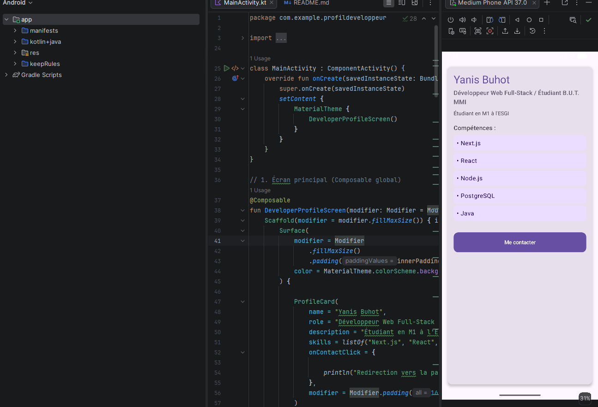

# Profil développeur Compose

## Description courte
Cette application Android minimaliste affiche une fiche de profil développeur construite entièrement avec Jetpack Compose. Elle met en valeur les informations clés d'un développeur (nom, rôle, description, compétences) et intègre une zone cliquable de contact respectant les normes d'accessibilité.

## Notions utilisées
- Composables (création de composants UI)
- Paramètres (pour rendre les composants dynamiques)
- Modifiers et chaînage de modifiers
- Padding externe / padding interne
- Callbacks (remontée d'événements)
- Previews (visualisation de différentes données)
- Accessibilité de base (sémantique et rôles)

## Explication courte
1. **Quels composables avez-vous créés ?**
   J'ai créé 5 composables : `DeveloperProfileScreen` (conteneur principal), `ProfileCard` (la carte globale), `ProfileHeader` (informations textuelles du haut), `SkillItem` (affichage d'une compétence) et `ContactAction` (le bouton personnalisé).
2. **Quel composable représente l'écran principal ?**
   C'est le composable `DeveloperProfileScreen` qui structure la racine de la page à l'aide d'un `Scaffold`.
3. **Où utilisez-vous un padding externe ?**
   J'utilise un padding externe dans `DeveloperProfileScreen` (sur l'appel de `ProfileCard`) pour écarter la carte des bords de l'écran, et sur les appels de `SkillItem` pour les espacer entre eux. Le composant parent décide de cet espace.
4. **Où utilisez-vous un padding interne ?**
   J'utilise un padding interne à l'intérieur de `ContactAction` (sur le `Text`) pour que le texte du bouton ne touche pas ses propres bordures, et dans la `Column` de `ProfileCard` pour aérer son contenu interne.
5. **Quel composant reçoit un callback ?**
   Les composants `ProfileCard` et `ContactAction` reçoivent le callback `onContactClick` passé en paramètre, qui est déclenché lors de l'interaction de l'utilisateur.
6. **Quelle information d'accessibilité avez-vous ajoutée ?**
   Sur ma zone cliquable personnalisée (`ContactAction`), j'ai défini le paramètre `role = Role.Button` dans le modifier `clickable`, et j'ai ajouté un bloc `semantics` avec une `contentDescription` pour fournir un contexte clair aux lecteurs d'écran.
7. **Pourquoi vos composants peuvent-ils être considérés comme réutilisables ?**
   Ils sont réutilisables car ils ne contiennent pas de données codées en dur (ils utilisent des paramètres comme `name`, `role`, `skills`) et acceptent tous un paramètre `modifier` optionnel. Ainsi, c'est le composant parent qui gère la donnée affichée et le placement externe.

## Capture d'écran
